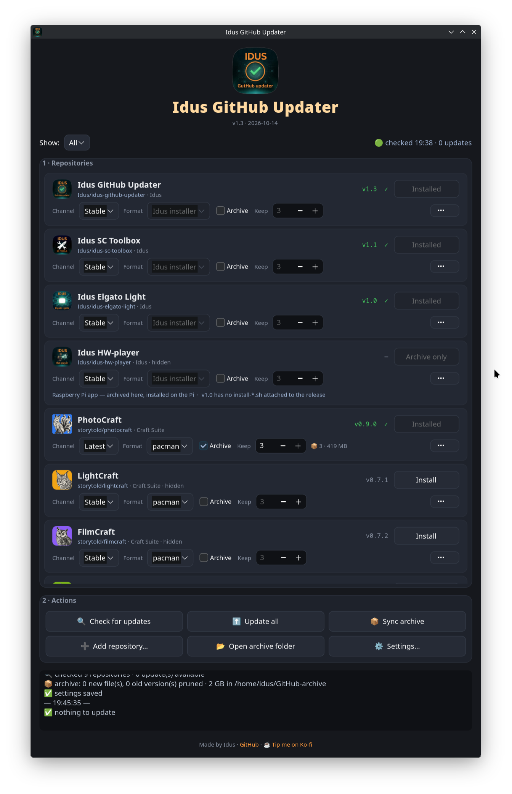

<div align="center">


# Idus GitHub Updater

**Install, update and archive apps from GitHub releases — the Arch way.**

A small GTK4 update manager for Arch Linux (CachyOS, EndeavourOS, Manjaro …) that keeps apps
published as GitHub releases installed and up to date — as real pacman packages or as
AppImages — and keeps the last few versions in an offline archive, so you can install or roll
back without a network. Ships with the Idus apps and the [Craft App Suite](https://getartcraft.com/apps)
(PhotoCraft, VectorCraft, FilmCraft …) as default repositories; add any other repository you like.


</div>

## Quick install

```bash
sudo pacman -S --needed python-gobject gtk4 base-devel && bash <(curl -fsSL https://github.com/Idus/idus-github-updater/releases/latest/download/install-idus-github-updater.sh)
```

Then open **Idus GitHub Updater** from the menu and install the rest from there.
Want to read the script first? See [Install](#install).



## Why

Lots of good software lives only on GitHub's release pages. You download a file, remember
to check back, download again, and when a new version breaks something the old file is long
gone. Idus GitHub Updater checks for you, installs the right build for your CPU in the format
you choose, verifies every file against the published SHA-256 checksums, and keeps an archive
of the last versions on disk — or on your NAS — for offline installs and rollbacks.

## Requirements

- Arch Linux or an Arch-based distro, KDE Plasma 6 recommended (any desktop works)
- Python + GTK4 bindings: `sudo pacman -S --needed python-gobject gtk4`
- For the **pacman** format: `sudo pacman -S --needed base-devel` (makepkg + fakeroot)
- Optional: `ksshaskpass` (password prompt that sudo remembers for a few minutes — part of Plasma),
  `libnotify` (desktop notifications), `fuse2` (some AppImages need it to start)

## Install

The [one-liner above](#quick-install) installs the dependencies and the latest release.
It runs `install-idus-github-updater.sh` from the latest release, which then fetches the app
itself — the same script you get in the release.

Prefer to read before you run? Download the three files from [Releases](../../releases),
put them in one folder and run `bash install-idus-github-updater.sh`.

- Launch from the menu ("Idus GitHub Updater") or the terminal (`idus-github-updater`).
- Right-click the menu entry for **Check for updates**, **Update all** and **Sync offline
  archive** — the result arrives as a desktop notification.
- Re-running the installer updates the app and keeps your settings.
- New icon not showing? Log out/in — the KDE icon cache is stubborn.

## Included repositories

The list starts with these. Nothing is installed until you press **Install** — and anything you
don't want can go: **⋯ › Hide** keeps it out of sight (Settings › *Show hidden repositories*
brings it back), **⋯ › Remove from list…** takes it off, and Settings › *Restore default
repositories* puts removed ones back. Add any other repository with **Add repository…**.

**Idus apps**

| App | What it is |
|---|---|
| [Idus GitHub Updater](https://github.com/Idus/idus-github-updater) | This app — it keeps itself up to date too |
| [Idus SC Toolbox](https://github.com/Idus/idus-sc-toolbox) | One-click fixes for Star Citizen on Linux (LUG Helper companion) |
| [Idus Elgato Light](https://github.com/Idus/idus-elgato-light) | Elgato Key Light, Ring Light and Light Strip control on Linux, with OpenDeck shortcuts |
| [Idus HW-player](https://github.com/Idus/idus-hw-player) | Random Halloween videos on a Raspberry Pi + projector — *archive only* here |

**[Craft App Suite](https://getartcraft.com/apps)** — free, open-source creative apps from the ArtCraft team

| App | What it is | App | What it is |
|---|---|---|---|
| [PhotoCraft](https://github.com/storytold/photocraft) | Image editing, layers, PSD | [WordCraft](https://github.com/storytold/wordcraft) | Word processing |
| [LightCraft](https://github.com/storytold/lightcraft) | Photo library and raw development | [DeckCraft](https://github.com/storytold/deckcraft) | Presentations |
| [FilmCraft](https://github.com/storytold/filmcraft) | Video editing, colour and sound | [GridCraft](https://github.com/storytold/gridcraft) | Spreadsheets |
| [DesignCraft](https://github.com/storytold/designcraft) | Page layout and publishing | [CADCraft](https://github.com/storytold/cadcraft) | Computer-aided design |
| [VectorCraft](https://github.com/storytold/vectorcraft) | Vector illustration | [SoundCraft](https://github.com/storytold/soundcraft) | Audio recording and editing |
| [PdfCraft](https://github.com/storytold/pdfcraft) | Reading, organising and protecting PDFs | [FigCraft](https://github.com/storytold/figcraft) | Interface design and prototyping |
| [EffectCraft](https://github.com/storytold/effectcraft) | Motion graphics and visual effects | | |

## How it works

### Idus apps

Idus apps use the **Idus installer** format: the release's own files (`<app>.py`, `<app>.png`, `install-<app>.sh`) are downloaded,
checked against their SHA-256 and `install-<app>.sh` is run as you (no root), exactly as if you
had downloaded the three files yourself. The installed version is read from the app itself
(`APP_VERSION` in `~/.local/share/<app>/<app>.py`), so apps you installed by hand are recognised.

- The updater can update itself — restart it afterwards. It won't uninstall itself.
- Idus HW-player runs on a Raspberry Pi, so here it is **archive only**: the archive keeps its
  files for the Pi, nothing is installed on this machine.
- Uninstalling an Idus app removes its folder in `~/.local/share` — including its settings.

### Two install formats for other apps — chosen per app

| Format | What happens | Good to know |
|---|---|---|
| **pacman** (default) | The release tarball is wrapped in a real pacman package with `makepkg` (`igu-<name>`), then installed with `pacman -U` | pacman owns every file, so it updates and uninstalls cleanly and shows up in `pacman -Q`. Asks for your password — see [Passwords](#passwords). Dependencies are worked out from the libraries the program uses. If a release ships a ready `.pkg.tar.zst`, that is used directly. |
| **AppImage** | The AppImage goes to `~/AppImages` with a menu entry and icon | No root, one file per app. Some AppImages need `fuse2`. |

Packages are named `igu-<name>` (Idus GitHub Updater), so they never clash with an AUR
package of the same name — and `paru`/`yay` won't try to "update" them from the AUR.
They `provide` and `conflict` with the plain name, so pacman tells you if the same app is
also installed from the AUR.

How the tarball becomes a package:

| Tarball contains | Installed as |
|---|---|
| `bin/`, `share/` … (like the Craft apps) | `/usr/bin`, `/usr/share` … |
| `usr/` | as is (`lib64` → `lib`, `sbin` → `bin`) |
| anything else | `/opt/igu-<name>/` + a link in `/usr/bin` |

The generated `PKGBUILD` stays in `~/.cache/idus-github-updater/build/` if you want to read it.

### Channels — per app

| Channel | Installs |
|---|---|
| **Stable** | the newest release *not* marked as a pre-release |
| **Latest** | the newest release, including alpha / beta / rc |
| **Pinned** | one version, until you change it (⋯ › Install another version › *Install & pin*) |

A release counts as a pre-release if GitHub marks it so **or** its tag says so
(`alpha`, `beta`, `rc`, `pre`, `preview`, `dev`, `nightly`, `canary`, `snapshot`).

### Offline archive

Tick **Archive** on an app and the last versions are kept in `~/GitHub-archive`
(changeable in Settings — point it at a NAS mount if you like), one folder per app and platform:

```
~/GitHub-archive/
└── PhotoCraft/
    ├── Linux/
    │   ├── v0.1.0/
    │   │   ├── photocraft-0.1.0-linux-x86_64.tar.gz
    │   │   ├── SHA256SUMS
    │   │   └── release.json          ← tag, date, release notes
    │   └── v0.1.1-rc.4/ …
    ├── Windows/                      ← optional, Settings › Also archive
    │   └── v0.1.0/photocraft-0.1.0-windows-x64.msi …
    └── macOS/ …
```

The app folder takes the app's name (`PhotoCraft (owner)` only if two apps share a name).
Archives from v1.0 (`<owner>/<repo>/<version>/`) are moved into this layout automatically.

- **Keep** sets how many versions per app (3 by default, 1–50 per app). The newest stable,
  a pinned version and the installed version are always kept on top of that.
- Old versions are pruned automatically; folders the app didn't create are never touched.
- Installs always use the archive first, so archived versions install **without a network**,
  and every archived file is re-checked against `SHA256SUMS` before it's used. (A sync only
  compares sizes, so it doesn't re-read a whole NAS each time.)
- *Also archive* (Settings) adds the other Linux format, Windows x64 and/or macOS installers —
  handy for offline installs on other machines.

### Already installed some other way?

Each row looks for the same app installed outside the updater — a pacman/AUR package
(`photocraft`, `photocraft-bin` …, or whatever owns `/usr/bin/photocraft`), a **Flatpak**
(`ai.storyteller.photocraft` — how ArtCraft Launcher installs apps when Flatpak is present),
a loose AppImage (`~/Applications`, `~/AppImages`, `~/.local/bin`) or ArtCraft Launcher's own
sandbox. If you then install with the updater you'd have two copies, and the menu may start
the old one — the row says so (⚠ two copies) and **⋯ › Remove the other install…** removes
the other copy (and its menu entry) after showing you exactly what goes.

### Passwords

pacman needs root. From the window and the menu actions the updater asks through **sudo with
a graphical prompt** (`ksshaskpass` on KDE), so sudo's normal memory applies: several installs
within a few minutes (Arch default: 5) ask once. **Update all** puts every pacman package in
one `pacman -U` anyway. Without ksshaskpass (or with `sudo-rs`, or if you're not in sudoers)
it falls back to the polkit dialog, which asks every time. In a terminal it's plain `sudo`.

Making pacman password-free (a polkit rule or `NOPASSWD` in sudoers) is possible but means
anything running as you can install anything as root — the updater deliberately doesn't offer it.
The AppImage format needs no password at all.

### Security

- Every download is checked against the published SHA-256 — GitHub's own asset digest, a
  `SHA256SUMS`-style file and/or `<file>.sha256`. When several exist they must agree.
  Files without a published checksum are refused unless you allow it in Settings.
- Downloads resume where they stopped and are only kept once they verify.
- The optional GitHub token is only ever sent to `api.github.com`, never to download hosts,
  and is stored in the settings file with mode 600. `GITHUB_TOKEN` in the environment works too.
- A running app is never replaced — close it first.

## What the buttons do

| Where | Button | Action |
|---|---|---|
| Row | Install / Update / Switch | Installs the channel's version (Switch: pinned version or new format) |
| | Channel · Format · Archive · Keep | Per-app settings, saved at once |
| | ⋯ › Release notes | Notes of the latest releases |
| | ⋯ › Install another version… | Any known version — archived ones (📦) offline. *Install & pin* stays there |
| | Repository name (under the app name) | Opens the repository on GitHub in your browser |
| | ⋯ › Open on GitHub / Open archive folder | Straight to the releases page / the app's archive folder |
| | ⋯ › Delete archived files… / Uninstall… | The archive and the install are separate — removing one keeps the other |
| | ⋯ › Remove the other install… | Removes a copy installed another way (Flatpak, AUR, loose AppImage); yours stays |
| | ⋯ › Hide / Remove from list… | Hide keeps the app's settings; Remove takes it off the list |
| Actions | Check for updates | Asks GitHub for new releases (and syncs the archive if that's on) |
| | Update all | Installs every update — all pacman packages in one password prompt |
| | Sync archive | Downloads missing archive versions, prunes old ones |
| | Add repository… | `owner/repo` or any github.com link |
| | Settings… | Folders, versions to keep, what to archive, checks, notifications, token |

The filter at the top shows All · Installed · Updates · Archived · Not installed.

### CLI

Every action has a flag, for KDE global shortcuts or a Stream Deck:

```bash
idus-github-updater --check | --list | --sync | --update-all \
                    --install REPO [--tag TAG] [--format pacman|appimage] [--pin] \
                    --uninstall REPO | --remove-other REPO \
                    --add OWNER/REPO [--name NAME] | --remove REPO \
                    [--offline] [--notify]
```

`REPO` is `owner/repo`, the repository name or the display name (`photocraft`, `PhotoCraft`).

## Notes & caveats

- **Arch only for the pacman format.** AppImages work on any distro, but the app is built and
  tested for Arch.
- **The Craft apps are young** (pre-1.0 at the time of writing) and move fast; some have no
  stable release yet — switch those to *Latest* if you want the pre-releases.
- **AppImageLauncher users:** keep the AppImage folder away from `~/Applications`, or
  AppImageLauncher adds a second menu entry for every app.
- **Rate limits:** without a token GitHub allows 60 API requests an hour; a check uses one per
  repository, and unchanged answers are cached. Add a token in Settings if you track many repositories.
- Only public repositories. Updates are checked when the app is open (on start, and hourly if
  you turn that on) or from the CLI / menu actions — there is no background service.
- The app's own settings and install records live next to it in `~/.local/share/idus-github-updater`;
  the log is in `~/.cache/idus-github-updater/`.
- Not affiliated with GitHub or the ArtCraft team. Use at your own risk.

## Uninstall

Remove the apps first if you want them gone (they're normal packages / files):

```bash
pacman -Qq | grep '^igu-'            # what the updater installed with pacman
sudo pacman -R $(pacman -Qq | grep '^igu-')
```

Then the updater itself:

```bash
rm -f  ~/.local/bin/idus-github-updater ~/.local/share/applications/idus-github-updater.desktop
rm -rf ~/.local/share/idus-github-updater ~/.cache/idus-github-updater
rm -f  ~/.local/share/icons/hicolor/512x512/apps/idus-github-updater.png
```

The offline archive (`~/GitHub-archive`) is yours to keep or delete.

## Support

Made by **Idus**. If this saved you time, buy me a coffee:

<a href='https://ko-fi.com/N4N2QZHKK' target='_blank'></a>

## License

MIT — see [LICENSE](LICENSE).
